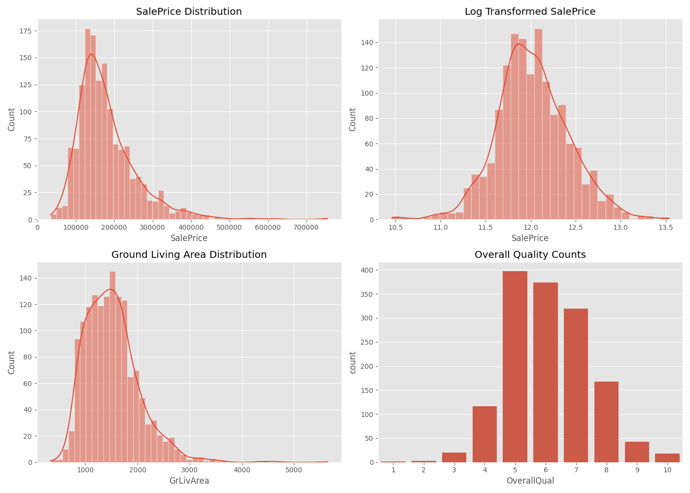
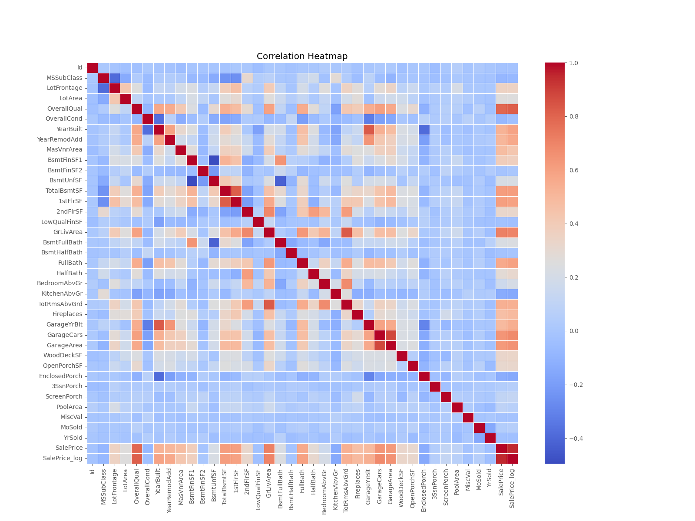
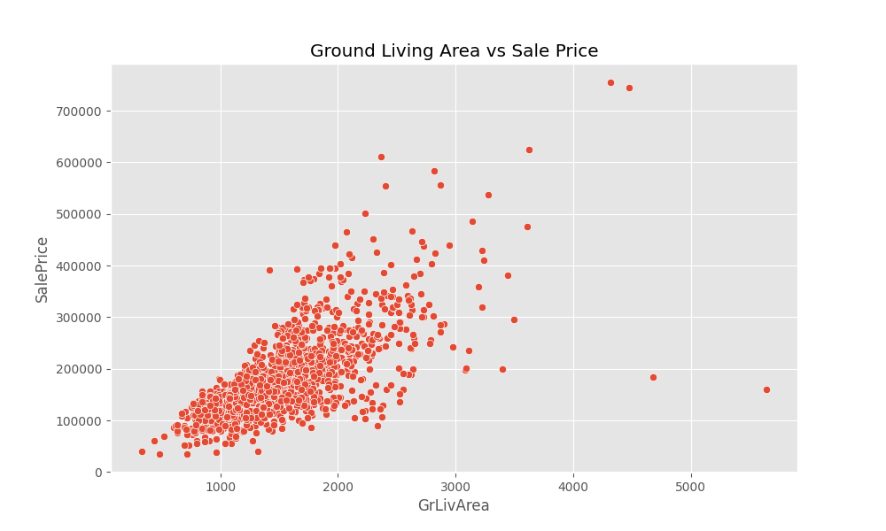

# 🏡 House Price Prediction — Exploratory Data Analysis (EDA)

[](https://www.python.org/)
[](https://jupyter.org/)
[-20BEFF.svg)](https://www.kaggle.com/competitions/house-prices-advanced-regression-techniques)
[]()

A comprehensive Exploratory Data Analysis (EDA) of the **Ames Housing Dataset** (from the Kaggle *House Prices: Advanced Regression Techniques* competition). This repository provides in-depth data profiling, missing value inspection, statistical distribution analyses, correlation mapping, outlier diagnostics, hypothesis testing, and actionable recommendations for downstream machine learning modeling.

---

## 📌 Table of Contents

- [Project Overview](#-project-overview)
- [Repository Structure](#-repository-structure)
- [Dataset Summary](#-dataset-summary)
- [EDA Methodology & Workflow](#-eda-methodology--workflow)
- [Key Insights & Visualizations](#-key-insights--visualizations)
  - [1. Feature Distributions](#1-feature-distributions)
  - [2. Correlation Heatmap](#2-correlation-heatmap)
  - [3. Outlier Analysis](#3-outlier-analysis)
- [Validated Hypotheses](#-validated-hypotheses)
- [Actionable Recommendations for Modeling](#-actionable-recommendations-for-modeling)
- [Getting Started](#-getting-started)
  - [Prerequisites](#prerequisites)
  - [Installation & Environment Setup](#installation--environment-setup)
  - [Running the Notebook](#running-the-notebook)
- [Tech Stack](#-tech-stack)

---

## 📖 Project Overview

Predicting residential home prices accurately requires understanding the complex interactions between physical dimensions, architectural quality, neighborhood characteristics, and temporal factors (such as year built and remodeled).

The primary goal of this repository is to conduct a rigorous exploratory analysis of the housing data to:
1. **Understand distributions and skewness** in the target variable (`SalePrice`) and key numerical predictors.
2. **Quantify missingness** and determine whether null values indicate missing data or the semantic absence of an amenity (e.g., no pool, no fireplace).
3. **Discover strong linear and non-linear relationships** with house prices to guide feature selection.
4. **Identify outliers and high-leverage points** that could bias regression algorithms.
5. **Formulate concrete feature engineering steps** for predictive modeling.

---

## 📂 Repository Structure

```text
house-price-prediction/
│
├── data/
│   ├── train.csv                # Training dataset (1,460 observations, 81 columns)
│   └── test.csv                 # Test dataset (1,459 observations, 80 columns)
│
├── images/
│   ├── distributions.png        # 2x2 grid of key distribution & count plots
│   ├── heatmap.png              # Correlation matrix heatmap across numerical features
│   └── outliers.png             # Bivariate scatter plot (GrLivArea vs. SalePrice)
│
├── notebook/
│   └── eda.ipynb                # Complete interactive Jupyter notebook with all EDA steps
│
├── .gitattributes               # Line normalization configuration
├── .gitignore                   # Ignored files (virtual environments, caches, checkpoints)
├── requirements.txt             # Pinned project dependencies
└── README.md                    # Project documentation & summary
```

---

## 📊 Dataset Summary

The dataset describes residential property sales in Ames, Iowa, with 79 explanatory features across 8 distinct architectural and geographic dimensions:

| Dataset Component | Count / Dimension | Description |
|---|---|---|
| **Training Records** | 1,460 rows | Contains features + target `SalePrice` |
| **Testing Records** | 1,459 rows | Evaluation split (features only, without `SalePrice`) |
| **Total Features** | 81 columns in `train.csv` | 1 ID column, 80 predictor features, 1 target |
| **Target Variable** | `SalePrice` | Property sale price in USD (continuous integer) |

### Feature Taxonomy
- **Property Size & Area**: `LotArea`, `GrLivArea` (above ground living area), `TotalBsmtSF`, `1stFlrSF`, `2ndFlrSF`, `GarageArea`.
- **Quality & Condition**: `OverallQual` (material and finish quality rated 1–10), `OverallCond` (overall condition rated 1–10), `ExterQual`, `KitchenQual`.
- **Age & Temporal**: `YearBuilt`, `YearRemodAdd`, `YrSold`, `MoSold`, `GarageYrBlt`.
- **Room & Amenity Counts**: `BedroomAbvGr`, `FullBath`, `HalfBath`, `TotRmsAbvGrd`, `Fireplaces`, `GarageCars`.
- **Location & Zoning**: `MSZoning`, `Neighborhood`, `Condition1`, `Condition2`.
- **Structural Types**: `BldgType`, `HouseStyle`, `Foundation`, `RoofStyle`.

---

## 🔍 EDA Methodology & Workflow

The analysis in [`notebook/eda.ipynb`](notebook/eda.ipynb) is organized into structured analytical stages:


1. **Basic Data Inspection**:
   - Examination of dimensions, data types, summary statistics (mean, median, standard deviation, quartiles), and identification of mixed datatypes.
2. **Missing Value Profiling**:
   - Quantified features with missing values and mapped them visually using `missingno`.
   - Identified that columns such as `PoolQC` (1,453 nulls), `MiscFeature` (1,406 nulls), `Alley` (1,369 nulls), `Fence` (1,179 nulls), and `FireplaceQu` (690 nulls) represent true feature absence rather than data collection loss.
3. **Target Variable Analysis**:
   - Evaluated the distribution of `SalePrice`. Observed noticeable positive skewness ($> 1.88$) and heavy right tails.
   - Applied a log transformation ($\log(1 + \text{SalePrice})$) which produced a well-behaved, near-normal distribution.
4. **Correlation & Multicollinearity**:
   - Generated a Pearson correlation matrix for all numerical variables.
   - Identified the most influential continuous/ordinal drivers of price and detected pairs of highly collinear features.
5. **Outlier Detection**:
   - Evaluated univariate outliers using the Interquartile Range (IQR) method:
     $$\text{IQR} = Q_3 - Q_1, \quad \text{Lower} = Q_1 - 1.5 \times \text{IQR}, \quad \text{Upper} = Q_3 + 1.5 \times \text{IQR}$$
     Identified 61 observations lying outside standard statistical bounds.
   - Analyzed bivariate leverage points in `GrLivArea` vs. `SalePrice`.
6. **Hypothesis Formulation & Testing**:
   - Formalized 3 intuitive real-estate hypotheses and validated each with statistical summaries and visualizations.
7. **Neighborhood & Segment Exploration**:
   - Analyzed price distribution variations across Ames neighborhoods, revealing strong geographical stratification.

---

## 📈 Key Insights & Visualizations

### 1. Feature Distributions



- **SalePrice Skewness**: Raw `SalePrice` displays substantial positive skewness with high-value luxury properties stretching the right tail.
- **Log Transformation**: Applying $\log(1 + x)$ successfully transforms the target into a bell-shaped, normal distribution, essential for linear regression algorithms.
- **Living Area Distribution**: `GrLivArea` is unimodal and slightly right-skewed, peaking between 1,000 and 1,800 sq ft.
- **Overall Quality Concentration**: `OverallQual` ratings follow an approximately normal distribution centered around grades 5, 6, and 7, with very few properties at the extreme ends (1–2 or 10).

---

### 2. Correlation Heatmap



#### Top Correlated Features with `SalePrice`

| Feature | Pearson Correlation ($r$) | Description |
|---|---|---|
| **`OverallQual`** | **0.791** | Rates the overall material and finish of the house |
| **`GrLivArea`** | **0.709** | Above ground living area in square feet |
| **`GarageCars`** | **0.640** | Size of garage in car capacity |
| **`GarageArea`** | **0.623** | Size of garage in square feet |
| **`TotalBsmtSF`** | **0.614** | Total square feet of basement area |
| **`1stFlrSF`** | **0.606** | First-floor square footage |
| **`FullBath`** | **0.561** | Full bathrooms above ground |
| **`TotRmsAbvGrd`** | **0.534** | Total rooms above ground (excluding bathrooms) |
| **`YearBuilt`** | **0.523** | Original construction date |
| **`YearRemodAdd`** | **0.507** | Remodel date (same as construction date if no remodel) |

> [!NOTE]
> **Multicollinearity Alert**: Several predictor pairs exhibit strong mutual correlation:
> - `GarageCars` $\leftrightarrow$ `GarageArea` ($r \approx 0.88$)
> - `TotalBsmtSF` $\leftrightarrow$ `1stFlrSF` ($r \approx 0.82$)
> - `GrLivArea` $\leftrightarrow$ `TotRmsAbvGrd` ($r \approx 0.83$)
> - `YearBuilt` $\leftrightarrow$ `GarageYrBlt` ($r \approx 0.83$)
>
> Feature engineering should consolidate or regularize these collinear pairs to avoid inflated variance in linear coefficients.

---

### 3. Outlier Analysis



- **Ground Living Area vs. SalePrice**: The scatter plot highlights a strong positive linear trend.
- **Extreme Leverage Points**: Two extreme outliers with $\text{GrLivArea} > 4{,}000\text{ sq ft}$ were sold for unusually low prices ($< \$200{,}000$). These represent abnormal/partial sales (as noted by dataset creator Dean De Cock) and should be removed before fitting models to avoid disproportionate influence on the regression line.

---

## 🧪 Validated Hypotheses

During the analysis, three fundamental domain hypotheses were empirically validated:

1. **Hypothesis 1: "Higher construction quality significantly increases house price."**
   - **Result**: **Confirmed**. `OverallQual` has the highest correlation with price ($r = 0.791$). Median price increases exponentially with quality ratings from grade 1 to 10.
2. **Hypothesis 2: "Larger living area leads to higher selling price."**
   - **Result**: **Confirmed**. Strong linear relationship ($r = 0.709$). The regression trend line in `GrLivArea` vs. `SalePrice` displays a consistent positive slope across all property categories.
3. **Hypothesis 3: "Garage capacity positively affects house prices."**
   - **Result**: **Confirmed up to 3 cars**. Median house prices rise progressively from 0-car, 1-car, 2-car, to 3-car garages. However, 4-car garages show greater variance and a slight median dip, indicating specialized, non-standard properties.

---

## 💡 Actionable Recommendations for Modeling

Based on the findings from this EDA, the following pipeline steps are recommended:

### 1. Missing Value Imputation Strategy
- **Categorical Structural NAs**: For features where `NA` indicates absence (`Alley`, `BsmtQual`, `BsmtCond`, `BsmtExposure`, `BsmtFinType1`, `BsmtFinType2`, `FireplaceQu`, `GarageType`, `GarageFinish`, `GarageQual`, `GarageCond`, `PoolQC`, `Fence`, `MiscFeature`), impute with a explicit category string `'None'`.
- **Numerical Missingness**:
  - `LotFrontage`: Impute with the median `LotFrontage` grouped by `Neighborhood`.
  - `GarageYrBlt`: Impute with `YearBuilt` (as garages are typically built simultaneously with the main structure) or encode an indicator feature `HasGarage`.
  - `MasVnrArea`: Impute with `0`.

### 2. Outlier Treatment
- Remove the two extreme outliers in the training set where $\text{GrLivArea} > 4{,}000\text{ sq ft}$ and $\text{SalePrice} < \$200{,}000$.

### 3. Feature Transformations
- **Target Transformation**: Model $\log(1 + \text{SalePrice})$ during training and use `np.expm1()` on test predictions to prevent heavy skewness from penalizing model loss.
- **Skewed Predictors**: Apply Box-Cox or $\log(1 + x)$ transformations to highly skewed continuous numerical features (e.g., `LotArea`, `1stFlrSF`, `GrLivArea`).

### 4. Feature Engineering Ideas
- `TotalSF` = `TotalBsmtSF` + `1stFlrSF` + `2ndFlrSF` (aggregate usable area).
- `TotalBath` = `FullBath` + `0.5 * HalfBath` + `BsmtFullBath` + `0.5 * BsmtHalfBath`.
- `HouseAge` = `YrSold` - `YearBuilt`.
- `Remodeled` = Binary indicator if `YearRemodAdd != YearBuilt`.
- `HasPool`, `HasGarage`, `HasFireplace` = Binary presence indicators for high-missing amenities.

### 5. Recommended Algorithms
- **Linear Baseline**: Ridge Regression ($\ell_2$) and Lasso ($\ell_1$) to automatically handle collinearity and feature selection.
- **Tree-Based Ensembles**: Random Forest, Gradient Boosting, LightGBM, XGBoost, and CatBoost.
- **Ensemble Stacking**: Blending regularized linear models with gradient boosting trees for optimal Kaggle score performance.

---

## 🚀 Getting Started

### Prerequisites

- Python 3.10 or higher
- Git

### Installation & Environment Setup

1. **Clone the repository**:
   ```bash
   git clone <repository-url>
   cd house-price-prediction
   ```

2. **Create and activate a virtual environment**:
   - **On Windows (PowerShell)**:
     ```powershell
     python -m venv venv
     .\venv\Scripts\Activate.ps1
     ```
   - **On macOS / Linux**:
     ```bash
     python3 -m venv venv
     source venv/bin/activate
     ```

3. **Install dependencies**:
   ```bash
   pip install -r requirements.txt
   ```

### Running the Notebook

Launch Jupyter Notebook or JupyterLab:

```bash
jupyter lab
```
*(or `jupyter notebook`)*

Open [`notebook/eda.ipynb`](notebook/eda.ipynb) and run all cells sequentially.

---

## 🛠 Tech Stack

- **Language**: Python 3.10+
- **Data Manipulation**: `pandas`, `numpy`
- **Data Visualization**: `matplotlib`, `seaborn`, `missingno`
- **Statistical Analysis**: `scipy`
- **Environment**: `jupyter`, `jupyterlab`

---

## 📜 License

This project is licensed under the MIT License - see the repository details for more information. Dataset is provided courtesy of Kaggle and Dean De Cock (Truman State University).
